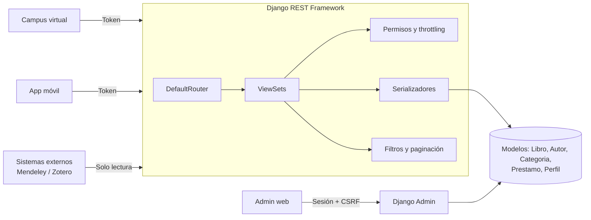

# Caso 1: API REST - Biblioteca Central UNCP

API RESTful con Django REST Framework para la gestión de libros, préstamos y usuarios de la Biblioteca Central de la UNCP. Permite la integración con el campus virtual, las apps móviles y sistemas externos.

**Curso:** Desarrollo de Aplicaciones Web (IS093A), UNCP. Semana 13.

## Tecnologías

| Componente | Uso |
|---|---|
| Django 5.2 + Django REST Framework 3.18 | API, serialización y ViewSets |
| django-filter | Filtros exactos y por rango |
| django-cors-headers | CORS para el campus y la app móvil |
| drf-spectacular + sidecar | OpenAPI 3, Swagger UI y ReDoc |
| rest_framework.authtoken | Autenticación por token (con expiración de 24 h) |

## Instalación

```bash
python -m venv venv
venv\Scripts\activate            # Windows  (Linux/Mac: source venv/bin/activate)
pip install -r requirements.txt
python manage.py migrate
python populate_data.py          # 50 libros, 12 usuarios, 30 préstamos
python manage.py runserver
```

| Usuario | Contraseña | Rol |
|---|---|---|
| `admin` | `Admin2026!` | Administrador (bibliotecario jefe) |
| `bibliotecario` | `Biblioteca2026!` | Personal de atención |
| `e.ramos`, `e.torres`, ... | `Biblioteca2026!` | Estudiantes |
| `d.castro`, `i.cardenas`, ... | `Biblioteca2026!` | Docentes / investigadores |

Pruebas unitarias: `python manage.py test`

## Arquitectura



```
caso1_biblioteca/
├── config/                 settings (DRF, CORS, throttling, logs), urls (docs, token)
├── biblioteca/
│   ├── models.py           Autor, Categoria, Libro, Perfil, Prestamo
│   ├── serializers.py      nested, HATEOAS, campos calculados, validaciones
│   ├── views.py            LibroViewSet, PrestamoViewSet, UsuarioViewSet (+ @action)
│   ├── permissions.py      EsBibliotecarioOAdmin, IsOwnerOrReadOnly, PuedeCrearPrestamo
│   ├── filters.py          LibroFilter (?categoria, ?año__gte, ?disponible) y ordenamiento con alias
│   ├── throttling.py       BurstRateThrottle (20/min)
│   ├── authentication.py   TokenConExpiracion (24 h)
│   ├── exceptions.py       registro de respuestas 429 en logs/api.log
│   └── tests.py            pruebas unitarias
├── populate_data.py        datos de prueba
├── postman/                colección exportada (.json)
└── demo_cors/              página para demostrar CORS en DevTools
```

## Endpoints

| Método | Endpoint | Permiso | Descripción |
|---|---|---|---|
| POST | `/api/auth/token/` | Público | Obtener token `{"username", "password"}` |
| GET | `/api/libros/` | Público | Catálogo paginado (20 por página) |
| GET | `/api/libros/{id}/` | Público | Detalle con autor completo |
| POST / PUT / PATCH | `/api/libros/` , `/api/libros/{id}/` | Admin o bibliotecario | Crear o actualizar |
| DELETE | `/api/libros/{id}/` | Solo admin | Eliminar |
| GET | `/api/prestamos/` | Autenticado | Los propios; el personal ve todos (`?limit=&offset=`) |
| POST | `/api/prestamos/` | Bibliotecario o admin | Registrar (máx. 5 activos, con stock) |
| POST | `/api/prestamos/{id}/devolver/` | Bibliotecario o admin | Marcar como devuelto y reponer stock |
| GET | `/api/prestamos/vencidos/` | Bibliotecario o admin | Préstamos vencidos con multa |
| GET | `/api/usuarios/` | Solo admin | Lista de usuarios |
| GET | `/api/usuarios/{id}/` | Autenticado | Vista privada (propio o admin) o pública |
| GET | `/api/usuarios/perfil/` | Autenticado | Perfil e historial del usuario actual |
| GET | `/api/docs/` , `/api/redoc/` | Público | Documentación Swagger y ReDoc |

### Ejemplos

```bash
# Token
curl -X POST http://127.0.0.1:8000/api/auth/token/ -H "Content-Type: application/json" \
     -d '{"username": "bibliotecario", "password": "Biblioteca2026!"}'
# -> {"token": "9944b09199c62bcf9418ad846dd0e4bbdfc6ee4b"}

# Filtros, búsqueda y orden
GET /api/libros/?categoria=ingenieria&año__gte=2018&ordering=-año
GET /api/libros/?disponible=true&search=algoritmos

# Registrar préstamo
curl -X POST http://127.0.0.1:8000/api/prestamos/ -H "Authorization: Token <token>" \
     -H "Content-Type: application/json" -d '{"usuario": 4, "libro": 2}'
```

Respuesta de un libro:

```json
{
  "id": 2,
  "url": "http://127.0.0.1:8000/api/libros/2/",
  "isbn": "9786120000021",
  "titulo": "Clean Code",
  "autor": {"id": 2, "nombre": "Robert C. Martin", "nacionalidad": "Estadounidense", "biografia": "..."},
  "editorial": "Prentice Hall",
  "anio": 2008,
  "categoria": "computacion",
  "stock": 3,
  "disponible": true,
  "ubicacion": "Piso 3 - Estante C-02"
}
```

## Decisiones de diseño

1. **Autor anidado en lectura y `autor_id` en escritura.** El cliente recibe el autor completo sin otra petición, pero crea libros enviando solo el id.
2. **Categoría por `slug`** (`?categoria=ingenieria`): las URLs quedan legibles y no dependen de ids.
3. **Alias con tilde** (`?año__gte`, `?ordering=-año`): se aceptan tal como pide el requerimiento, y el campo interno es `anio` (sin ñ) para evitar problemas en la BD y en el código.
4. **Estado `vencido` calculado al consultar** (`Prestamo.actualizar_vencidos()`), sin depender de una tarea programada.
5. **Stock con `F()` y `transaction.atomic`**: dos préstamos simultáneos no pueden dejar el stock negativo.
6. **Límite de 5 préstamos en dos capas:** el permiso `PuedeCrearPrestamo` responde 403 antes de validar, y el serializador lo vuelve a validar. Los vencidos cuentan como no devueltos.
7. **Serialización diferenciada:** el dueño o el admin ven email, teléfono e historial; los demás, solo nombre, tipo y carrera (minimización de datos).
8. **Préstamos ajenos responden 404, no 403**: no se revela que el recurso existe.
9. **Paginación:** `PageNumberPagination` (20) para el catálogo y `LimitOffsetPagination` para préstamos, que necesitan saltos arbitrarios.
10. **CSRF:** la API autentica con token (sin cookies), así que no necesita CSRF; el admin web usa sesión y mantiene CSRF.
11. **Seguridad:** los tokens expiran a las 24 h, HTTPS es obligatorio con `PRODUCCION=1`, hay logs de auditoría (crear o eliminar libros, préstamos y devoluciones) y logs de throttling (429) en `logs/api.log`.
12. **Rendimiento:** `select_related` y `prefetch_related` (sin N+1), `annotate(Count)` para `prestamos_activos` e índices en `anio`, `titulo`, `stock`, `estado` y `fecha_devolucion`.

## Throttling

| Clase | Límite | Propósito |
|---|---|---|
| `AnonRateThrottle` | 100/hora | Catálogo público |
| `UserRateThrottle` | 1000/hora | Usuarios autenticados |
| `BurstRateThrottle` | 20/minuto | Evitar el scraping |

## CORS

Orígenes permitidos: `https://campus.uncp.edu.pe`, `https://app-movil.uncp.edu.pe` y `http://127.0.0.1:5500` (solo para la demo local). Para la demo:

```bash
cd demo_cors
python -m http.server 5500
# abrir http://127.0.0.1:5500/cors_test.html  ->  F12 > Network > access-control-allow-origin
```
