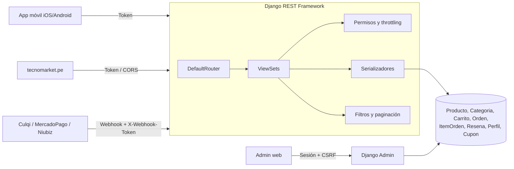

# Caso 2: API REST - TecnoMarket Perú (e-commerce)

API RESTful con Django REST Framework para el e-commerce TecnoMarket Perú: catálogo de productos tecnológicos, carrito, órdenes, reseñas y marketplace de vendedores. Está pensada para la app móvil, las pasarelas de pago (Culqi, MercadoPago, Niubiz) y la logística (Olva, Shalom).

**Curso:** Desarrollo de Aplicaciones Web (IS093A), UNCP. Semana 13.

## Tecnologías

| Componente | Uso |
|---|---|
| Django 5.2 + Django REST Framework 3.18 | API, serialización y ViewSets |
| django-filter | Filtros por categoría, marca, rango de precio y disponibilidad |
| django-cors-headers | CORS para la web, la app y el panel de TecnoMarket |
| drf-spectacular + sidecar | OpenAPI 3, Swagger UI y ReDoc con ejemplos |
| rest_framework.authtoken | Autenticación por token (expira en 24 h) |

## Instalación

```bash
python -m venv venv
venv\Scripts\activate            # Windows  (Linux/Mac: source venv/bin/activate)
pip install -r requirements.txt
python manage.py migrate
python populate_data.py          # 100 productos, 21 usuarios, 50 órdenes, 100 reseñas
python manage.py runserver
```

| Usuario | Contraseña | Rol |
|---|---|---|
| `admin` | `Admin2026!` | Administrador (owner) |
| `v.techstore`, `v.gamerzone`, `v.compuandina`, `v.movilplus` | `Tecno2026!` | Vendedores |
| `c.ramos`, `c.torres`, `c.quispe`, ... (16) | `Tecno2026!` | Clientes |

Cupones de prueba: `TECNO10` (10 %) y `CYBERWOW20` (20 %). Pruebas unitarias: `python manage.py test`

## Arquitectura



```
caso2_tecnomarket/
├── config/                 settings (DRF, CORS, throttling, logs), urls (docs, token)
├── tienda/
│   ├── models.py           Producto, ImagenProducto, Categoria, Carrito, ItemCarrito,
│   │                       Orden, ItemOrden (snapshot), Resena, Perfil, Cupon
│   ├── serializers.py      nested, HATEOAS, campos calculados, checkout transaccional
│   ├── views.py            Producto, Carrito, Orden y Resena ViewSets (+ @action) y webhook
│   ├── permissions.py      PuedeVender, EsCompradorVerificado, IsOwnerOrReadOnly, PuedeActualizarOrden
│   ├── throttling.py       CheckoutRateThrottle (10/h), SearchRateThrottle (100/h)
│   ├── pagination.py       PageNumber (24) para el catálogo y LimitOffset (50) para órdenes
│   ├── filters.py          ProductoFilter
│   └── tests.py            pruebas unitarias
├── populate_data.py        datos de prueba
├── postman/                colección exportada (.json)
└── demo_cors/              página para demostrar CORS en DevTools
```

## Endpoints

| Método | Endpoint | Permiso | Descripción |
|---|---|---|---|
| POST | `/api/auth/token/` | Público | Obtener token |
| GET | `/api/productos/` | Público | Catálogo (24 por página) |
| GET | `/api/productos/{id}/` | Público | Detalle con especificaciones |
| POST | `/api/productos/` | Vendedor o admin | Publicar producto |
| PUT / PATCH | `/api/productos/{id}/` | Dueño o admin | Actualizar |
| DELETE | `/api/productos/{id}/` | Solo admin | Eliminar |
| GET | `/api/productos/{id}/reseñas/` | Público | Reseñas de un producto |
| GET | `/api/carrito/` | Autenticado | Ver carrito actual |
| POST | `/api/carrito/agregar/` , `actualizar/` , `eliminar/` , `vaciar/` | Dueño | Gestionar el carrito |
| POST | `/api/carrito/aplicar-cupon/` | Dueño | Aplicar cupón |
| POST | `/api/carrito/checkout/` | Dueño (10/h) | Convertir el carrito en orden |
| POST | `/api/ordenes/` | Cliente | Crear orden desde el carrito |
| GET | `/api/ordenes/` | Autenticado | Propias; el vendedor ve las de sus productos; el admin, todas |
| PATCH | `/api/ordenes/{id}/` | Admin o vendedor | Cambiar estado |
| POST | `/api/ordenes/{id}/cancelar/` | Comprador o admin | Cancelar (solo `pendiente`) |
| GET | `/api/ordenes/mis-ordenes/` | Autenticado | Órdenes del usuario |
| GET / POST | `/api/reseñas/` | Público / comprador verificado | Listar o crear |
| DELETE | `/api/reseñas/{id}/` | Autor o admin | Eliminar |
| POST | `/api/webhooks/pago/` | `X-Webhook-Token` | Confirmación de la pasarela |
| GET | `/api/docs/` , `/api/redoc/` | Público | Documentación |

### Ejemplos

```bash
GET /api/productos/?categoria=laptops&marca=dell&precio_min=500&precio_max=5000&disponible=true
GET /api/productos/?search=gaming laptop&ordering=-rating_promedio

POST /api/carrito/agregar/      {"producto": 1, "cantidad": 2}
POST /api/carrito/checkout/     {"direccion_envio": "Jr. Puno 456, Huancayo", "metodo_pago": "culqi"}
PATCH /api/ordenes/51/          {"estado": "enviada"}     -> genera numero_seguimiento
POST /api/reseñas/              {"producto": 1, "calificacion": 5, "titulo": "Excelente"}
```

Respuesta del checkout (201):

```json
{
  "id": 51,
  "numero": "56dd04b4-0bb6-44d5-ad2c-35dc7c68a3a3",
  "items": [{"sku": "MON-VIEW-020", "nombre_producto": "ViewSonic VX2479 24\" Full HD",
             "precio_unitario": "413.10", "cantidad": 1, "subtotal": "413.10"}],
  "estado": "pendiente",
  "subtotal": "413.10", "descuento": "41.31", "impuestos": "66.92", "total": "438.71",
  "numero_seguimiento": "",
  "tiempo_estimado_entrega": {"desde": "2026-11-29", "hasta": "2026-12-01"}
}
```

## Flujo de estados de una orden

```
pendiente --> pagada --> enviada --> entregada
    |            |
    +------------+--> cancelada
```

Cualquier otra transición responde **400**. El número de seguimiento se genera al pasar a `enviada`, y al cancelar se repone el stock.

## Decisiones de diseño

1. **Snapshot en `ItemOrden`:** guarda nombre, SKU y precio del momento de la compra; si luego cambia el precio del producto, la orden no se altera.
2. **Un solo carrito activo por usuario**, garantizado en la base de datos con `UniqueConstraint(condition=Q(activo=True))`, no solo en el código.
3. **Checkout atómico:** `transaction.atomic` + `update(stock=F("stock") - n)` con la condición `stock__gte`. Si dos clientes compran el último producto, solo uno lo consigue.
4. **El carrito es un recurso único** (`/api/carrito/`) con acciones `detail=False`: el cliente nunca maneja ids de carrito, así que no puede tocar el de otro.
5. **`rating_promedio` y `total_resenas` anotados con `Avg` y `Count`** en la misma consulta: permiten `?ordering=rating_promedio` sin N+1.
6. **Permisos por actor:** `PuedeVender` (publicar), `IsOwnerOrReadOnly` (editar solo lo propio), `EsCompradorVerificado` (reseñar solo lo comprado), `PuedeActualizarOrden` (admin o vendedor de los productos).
7. **Throttling por riesgo:** anónimos 60/h (scraping de precios), usuarios 2000/h, `SearchRateThrottle` 100/h (solo cuenta las peticiones con `?search=`) y `CheckoutRateThrottle` 10/h (abuso de checkout). Cada 429 queda en `logs/api.log`.
8. **Paginación:** `PageNumberPagination` de 24 (grilla de 4 x 6 en la app) y `LimitOffsetPagination` de 50 para órdenes (reportes).
9. **Webhook con token compartido** (`X-Webhook-Token`), sin sesión ni CSRF, para que la pasarela confirme el pago.
10. **CSRF:** la API usa tokens (sin cookies), así que no necesita CSRF; el admin web lo mantiene. Hay HTTPS obligatorio con `PRODUCCION=1`, tokens que expiran a las 24 h y logs de auditoría (productos, checkout, cambios de estado y cancelaciones).
11. **Programa de fidelidad:** 1 punto por cada S/ 10 de compra (`Perfil.puntos`).
12. **Mejoras futuras:** JWT con `simplejwt` para la app móvil, caché con Redis para el catálogo, Celery para notificaciones y CI con GitHub Actions.

## CORS

Orígenes permitidos: `https://tecnomarket.pe`, `https://app.tecnomarket.pe`, `https://admin.tecnomarket.pe` y `http://127.0.0.1:5500` (solo para la demo local).

```bash
cd demo_cors
python -m http.server 5500
# abrir http://127.0.0.1:5500/cors_test.html  ->  F12 > Network > access-control-allow-origin
```
